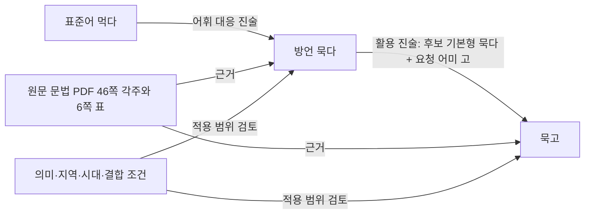

# 문헌 전체 기반 KG v2 초안

기존 `current_kg`를 보존하고 만든 별도 KG다. gpt-6-astra가 등록 문헌 7종의 전체 474쪽을 읽고 3,757개 진술을 작성했다. 기존 진술을 복사해 새 형식으로 바꾸는 대신 원본 PDF에서 다시 추출한 본문·표·각주를 검토했다. 문헌 전체를 작업 범위로 삼되 실제 읽기와 작성은 문헌·절 단위로 진행했다.

**현재 상태는 문헌 전체 기반 초안의 병렬 보완·통합 검토까지 마친 단계다.** 1차 초안 2,379개 진술 이후 Astra 작업자 3개가 원래 검토 한계를 기록한 162쪽을 분담했다. 1,378개 진술을 추가하고 기존 759개 진술을 수정·보강했다. 원래 162쪽의 처리 결과는 해결 84쪽, 일부 해결 0쪽, 원문·자료 한계 78쪽이다.

각 처리 이유와 현재 남아 있는 제약은 [통합 감사](reports/integration_audit.json), [페이지별 한계](reports/extraction_gaps.json)에 남겼다. 문헌의 모든 문장을 독립 규칙으로 바꾸거나 문장 번역을 검증했다는 뜻은 아니다. 2026-10-12 후속 작업에서 문장 분석·생성 연결과 개발 비교를 실행했다. 최신 실행 상태는 아래 절과 [번역 보고서](reports/translation_20261012/README.md)를 따른다.

## 이번 구조의 핵심

어미만 독립적으로 모으지 않고 표준어 대응, 방언 기본형, 실제 활용형, 기능, 조건, 적용 범위와 원문 근거를 구별했다. 하나의 지식 진술이 이 요소들을 묶는다. 같은 표면형이라도 출처·용법별 표현 노드를 유지하며 자동 병합하지 않는다.



실제 그래프는 `KnowledgeStatement`, 출처별 `ExpressionUse`, `Condition`, `Constraint`, `Function`, `Evidence`, `SourcePage`, `Source` 노드로 구성된다. 두 진술 사이의 `candidate_has_inflection` 관계는 어휘 대응의 목표 기본형과 활용의 기본형을 연결한다. 이 관계가 있다고 두 진술의 의미·지역 범위가 일치한다고 단정하지 않는다. 문헌 간 재인용·공유 이력도 `document_dependency` 관계로 남긴다.

조건에는 판정 대상이 있다. `input`은 표준어 입력 분석, `candidate`는 선택한 방언 어휘·어간, `target`은 목표 말투, `context`는 발화 상황이다. 따라서 표준어 ‘먹다’를 입력해 놓고 입력 자체가 ‘묵다’여야 한다고 요구하는 오류를 피한다. 판별 정보가 빠졌으면 조건은 `unknown`으로 남는다.

실제 확인형, 일반화, 저자 가설, 이차 인용, 작성자 해석, 부정 예문을 구분했다. `candidate`는 조회 후보라는 뜻이며 자동 생성 승인이라는 뜻은 아니다. 자유 서술로 남은 제약, 의미·지역 판단은 조회 결과에서도 검토 필요 상태를 유지한다. ‘카드’는 이 KG의 노드 유형이 아니다. 향후 생성 모델에 보내는 묶음을 만들더라도 원래 진술과 관계를 추적할 수 있어야 한다.

## 범위와 산출물

| 문헌 | PDF 쪽수 | 진술 수 |
|---|---:|---:|
| 양지현, 경남방언 어말어미 -거로 | 22 | 58 |
| 조현준, 경북방언의 종결어미 연구 | 265 | 1,203 |
| 류성기, 경남 함양 방언 문법 형태 변화 | 38 | 160 |
| 동남 방언 개요 | 55 | 450 |
| 동남 방언 문법 | 51 | 1,463 |
| 동남 방언 상대 높임법 | 35 | 305 |
| 동남 방언 음운 | 8 | 118 |
| 합계 | 474 | 3,757 |

650개 어휘 대응, 675개 활용, 608개 종결어미 진술을 포함한다. 개수는 출처·조건·실제 표 셀을 구별한 진술 수이며 독립적인 규칙 또는 어휘 수가 아니다. 어휘 대응 44개에 활용 관계 484개가 연결됐다. 명사 등 활용 대상이 아닌 항목도 포함되므로 이 비율을 동사 활용 포괄률로 해석하지 않는다.

- [authored/](authored/): Astra가 작성한 출처별 진술. 수정을 시작할 원본 데이터다.
- [facts.jsonl](facts.jsonl), [graph.json](graph.json): 빌드된 진술과 그래프. 그래프는 25,750개 노드, 35,308개 관계다.
- [source_registry.json](source_registry.json): 대상 PDF·해시·범위·문헌 의존성. 별도 어휘 후보 자료와 평가용 말뭉치는 이번 7종에 포함하지 않았다.
- [reviews/](reviews/), [page_coverage.tsv](reports/page_coverage.tsv): 전체 페이지의 검토·서지·공백·추출 한계 대장. 페이지는 인쇄 지면이 아닌 1부터 시작하는 PDF 쪽수다.
- [build_summary.json](reports/build_summary.json): 규모·해시·보존 검사 결과.
- [query_diagnostics.json](reports/query_diagnostics.json): 실제 조회 경로, 조건 판정, 제외 결과.
- [AUTHORING.md](AUTHORING.md), [fact.schema.json](fact.schema.json): 작성 및 검증 계약.

## 확인된 조회 결과

아래는 기본형과 요청 어미를 직접 제공한 구조 진단이다. 문장 형태소 분석이나 번역 정답 평가를 대신하지 않는다.

| 입력 분석 | 조회된 활용 후보 |
|---|---|
| 먹다 + -고 | 묵고 |
| 먹다 + -아/어라 | 묵어라, 무우라 |
| 버리다 + -고 | 버리고, 베리고, 삐고, 뿌고 — 뜻을 결정하기 전에는 함께 보존 |
| 데우다 + -고 | 뎁히고, 뎁후고 |
| 내리다 + -고 | 내루고 |
| 빠뜨리다 + -고 | 빠줗고, 빠주고 — 발음형 빠주코는 제외 |
| 먹다 + 문헌에 없는 어미 | 후보 없음 |

먹다→묵다는 문법 PDF 46쪽 [21] 각주와 6쪽 표를 함께 근거로 삼는다. 묵고는 6쪽 원본 표의 -고 열을 이미지로 확인했다. PDF 텍스트의 열 사이 줄바꿈을 그대로 단어 경계로 해석하지 않았다. 문법 PDF 17쪽의 삐다/뿌다 표는 -아가 열에 삐가/삐가가 중복 표기되어 있다. 이 셀은 원본 이미지로 대조한 뒤 불확실한 참고 항목으로 보존했으며 ‘뿌가’로 임의 교정하지 않았다.

## 재현

원본 PDF는 프로젝트의 기존 로컬 `sources/`에 있어야 한다. 전체 추출 본문은 `local/`에만 보관한다. `pdftotext`와 Python `jsonschema`가 필요하며 현재 프로젝트의 `.venv/retrieval/bin/python`으로 빌드할 수 있다.

```bash
python kg_v2/extract_sources.py
.venv/retrieval/bin/python kg_v2/build.py --require-full
.venv/retrieval/bin/python -m unittest discover -s kg_v2 -p 'test_*.py' -v
python kg_v2/diagnose.py
python kg_v2/integration_audit.py
python kg_v2/query.py --lemma 먹다 --ending=-고
```

빌드는 PDF·추출 본문 해시, 진술 스키마, 인용 문자열의 실제 페이지 내 존재, 검토 진술의 페이지 연결, 전체 페이지 누락 여부, 기존 KG 169개 보호 파일 해시를 검사한다. 인용 문자열이 존재한다는 검사는 그 인용이 진술 전체를 충분히 뒷받침한다는 의미 판정을 자동으로 보장하지 않는다. 그 부분은 작성 검토와 후속 감사 대상이다.

초안 조회 회귀 테스트 9개는 표준어→방언 기본형→활용 경로, 의미별 어휘 선택, 미등록 어미, 미확인 조건, 의문형 결합 조건, 부정 예문·참고 자료의 적용 차단, 원문 표의 의심 셀 처리를 검증했다. 현재 모든 검사가 통과했다. 기존 KG 보호 파일 169개의 해시는 작업 시작 시점과 같다.

## 병렬 검토 결과와 남은 경계

- [JO2018 검토](reports/jo_review_completion.json): 지역별 빈도표와 선행연구 어미표를 연구자·높임체·지역별로 보완하고 원문 수치의 모순을 보존했다.
- [문법·상대높임법 검토](reports/grammar_honorific_review_completion.json): 표 셀과 어휘 각주를 직접 연결하고 표기형·발음형·불확실한 형태를 구별했다.
- [나머지 문헌 검토](reports/other_sources_review_completion.json): 함양 높임 범주의 과잉 해석을 수정하고, 긴 발화의 식별 가능한 대응쌍 및 음운의 적용 범위를 보강했다.
- [통합 의미 검토](reports/integration_semantic_review.json): 조정자의 원문·이미지 표본 대조와 작업자 간 교차 검토, 발견된 인용 오류의 수정 내역이다. 원문 문자열 검사는 전체에 적용하지만 의미의 독립 전수 검증은 아니다.
- [통합 기계 검사](reports/integration_audit.json): 원래 162쪽의 처리 추적, 기존 진술 ID 보존, 페이지 대장·그래프 끝점·활용 연결·해시 일치를 확인한다.

현재 페이지 대장에 제약이 남은 쪽은 79쪽이다. 원래 한계 78쪽에, 이번에 명시적으로 기록한 문법 PDF 17쪽의 중복 표기 문제가 더해진 수다. 원문 숫자 불일치, 원음·인용 원전의 미확보, 명시되지 않은 지역, 뜻을 판독할 수 없는 전사는 추측으로 채우지 않았다. 표준어와 동일한 반복 표현이나 모든 음절의 형태소 분해를 독립 사실로 재생산하지 않는다. 원문이 뒷받침하는 구별 가능한 대응·용법·조건과 표 항목을 추출 단위로 삼는다.

같은 Astra를 사용한 분담·교차 검토는 사람 전문가나 다른 모델의 독립 평가가 아니다. 자유 서술 조건, 문헌 간 의미 동일성·상충 및 지역·시대 적합성의 자동 판정은 여전히 별도 과제다. 조회 결과는 검토 가능한 후보이며 자동 생성 승인이 아니다.

문헌 추출과 조회 검사를 문장 번역 품질의 증명으로 해석하지 않는다. 후속 문장 실험의 출력과 품질 진단은 아래 실행 결과에서 분리해 기록한다.

## 문장 분석·생성 연결 및 Neo4j — 2026-10-12 후속

`run_translation.py`가 Qwen 입력 분석 → 원문 결속 검증·Kiwi 형태 분석 → KG v2 후보/활용 경로 조회 → Qwen 생성까지 연결한다. 기존 KG와 새 KG의 원본은 변경하지 않는다. 실제 원문 구간, 기본형, 선어말어미와 어미가 참조에 포함된다. `blocked`·`reference_only`·구조화 조건 미확인 후보는 생성 참조에서 제외한다. 원문의 과거·높임 형태가 남아 있는데 표의 현재형으로 덮어쓰지 않도록 활용 조회를 제한했다. 자유 서술 제약·의미·지역 판단은 여전히 생성 모델이 해석하므로 품질 승인을 뜻하지 않는다.

```bash
# 현재 프로젝트 실행 환경. 분석 호출은 최대 180초까지 기다린다.
.venv/retrieval/bin/python kg_v2/run_translation.py translate \
  --text '나는 배가 고파서 먼저 밥을 먹고 있을게.' \
  --folder kg_v2/local/my_translation

# 동일한 38개 개발 입력의 네 조건 비교. 새 폴더를 사용한다.
.venv/retrieval/bin/python kg_v2/run_translation.py prepare --folder kg_v2/local/new_comparison
.venv/retrieval/bin/python kg_v2/run_translation.py generate --folder kg_v2/local/new_comparison
```

실시간 실행은 기존 로컬 모델 연결 설정을 사용한다. 비교 준비는 기존 개발 분석·조회 캐시가 필요하며, 이번 실험의 고정 분석·참조·실제 요청은 보고서에 보존한다. 환경 의존성은 `requirements-translation.txt`와 기존 `current_kg/experiments/requirements-*.txt`를 따른다.

- [최종 번역 비교·진단](reports/translation_20261012/README.md), [38개 입력의 출력 전체](reports/translation_20261012/comparison.txt)
- [입력 분석·조회·생성 구현 검사](reports/translation_20261012/implementation_verification.json): 총 15개 테스트. 모델 출력의 자연스러움 검사와 구별한다.
- [Neo4j 시각화 안내](reports/neo4j/README.md), [전체 구조 PNG](reports/neo4j/schema.png), [먹다→묵다→묵고 PNG](reports/neo4j/eating_path.png)

PNG는 Neo4j에 실제 적재한 데이터를 조회하여 Graphviz로 렌더링했다. 전체 노드·관계·속성의 왕복 일치를 검증했으며 기존 Neo4j 그래프는 보존했다.
